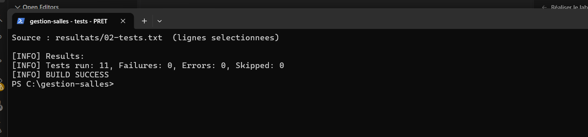
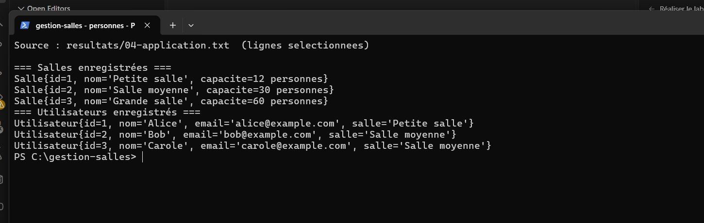
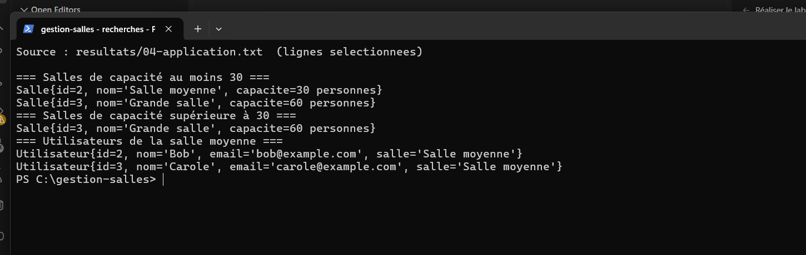
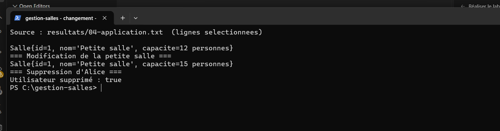
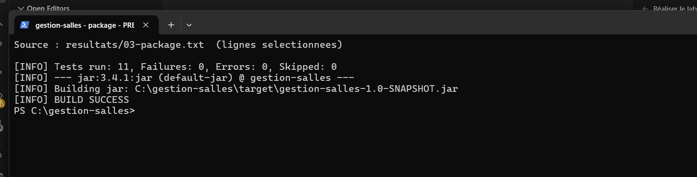

# Lab 2 – Gestion des salles et des utilisateurs

## Objectif

Créer une petite application Java qui enregistre des salles et des utilisateurs avec JPA et Hibernate, sans serveur d'applications.

## Technologies

Java 11 (exécuté avec JDK 17), Maven, JPA 2.2, Hibernate Core 5.6, H2 en mémoire et JUnit 4.

## Fonctionnalités

- Ajouter, consulter, modifier et supprimer des salles et des utilisateurs.
- Affecter plusieurs utilisateurs à une même salle.
- Rechercher les salles par capacité et les utilisateurs par salle ou par nom avec JPQL.
- Vérifier les transactions et les contraintes d'unicité avec des tests JUnit.

## Exécution

Dans un terminal PowerShell ouvert à la racine du projet :

```powershell
$env:JAVA_HOME = 'C:\Program Files\Eclipse Adoptium\jdk-17.0.16.8-hotspot'
$env:Path = "$env:JAVA_HOME\bin;$env:Path"
mvn clean compile
mvn clean test
mvn package
mvn compile exec:java
```

Dans IntelliJ IDEA, sélectionner le JDK 17 puis lancer `com.example.jpa.App`.

## Résultats

La dernière exécution compte **11 tests réussis et 0 échec**. Les tests, le packaging et la démonstration se terminent par `BUILD SUCCESS`. Les images ci-dessous sont de **vraies captures d'une fenêtre PowerShell** affichant des lignes sélectionnées des journaux du dossier [`resultats/`](resultats/).

**1. Tests JUnit.**



**2. Salles et utilisateurs enregistrés.**



**3. Recherches JPQL par capacité et par salle.**



**4. Modification d'une salle et suppression d'Alice.**



**5. Packaging Maven réussi.**



## Conclusion

Ce TP montre comment gérer des données liées avec JPA et Hibernate dans une application Java simple. Les tests confirment le fonctionnement des opérations principales et des recherches.
